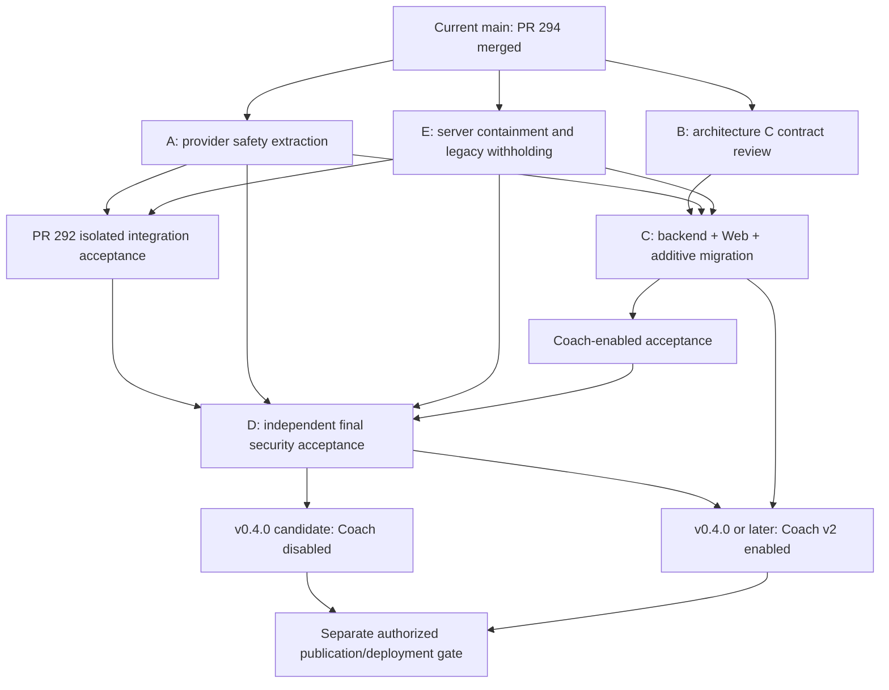

# Phase 1 security roadmap and proposed Issues

Status: proposed Issues only; none created. No implementation PR, merge, settings change, release or deployment authorized by this document. Snapshot 2026-10-13; [verified SHAs and inventory](pr295-split-assessment.md).

## Recommendation and dependency graph

Merge independently reviewed provider fixes first; do not wait for Coach redesign to reduce unrelated exposure. In parallel planning terms, prioritize central server-side Coach containment; do not ship multi-user Coach free text while #295's known P1 remains. Containment must also cover historical output and shared Coach transport consumers. Four requested Issues A–D plus a small urgent Issue E make five, because a kill switch should not depend on completing a redesign.



Graph interpretation: C→ON→D is mandatory for the **enabled** profile only. The disabled profile can complete D after A+E+accepted #292 with C outstanding; D must explicitly label that reduced scope and prove all unsafe paths unreachable. Neither profile currently passes. Diagram nodes are prerequisites, not permission to merge or deploy. B is this contract's future review/ratification; it does not require implementing production code.

Proposed PR sequence: **A provider safety → E containment/history → #292 integration after new-head verification → C implementation (after B approval) → D acceptance evidence → refreshed #293 candidate**. A and E can be reviewed independently from the same main; integrate each on the latest main without assuming tests on an earlier head apply. If E can safely land sooner, reverse A/E: minimize exposed time. No implementation branches or PRs are created in this task. Documentation is a separate Draft PR.

## Issue A — Extract independent provider-error confidentiality fixes from #295

**Background:** main lacks OCR, IBKR and notification provider-diagnostic protection even though #294's ownership fixes merged. #295 mixes reusable fixes with blocked Coach output guards.

**Scope:** shared safe error formatting, OCR extraction/model discovery and handler response, IBKR direct/background sync, webhook and Expo per-ticket failures, new status persistence, historical DTO readback, safe logging. Apply inventory A and eligible C hunks from reviewed SHA. Include both owner-only OCR/Coach model-discovery callers because they share `ocr.ListModels`; do not broaden settings permissions.

**Non-goals:** Coach free-text acceptance, News successful-output redesign, accounting/import semantics, historical row deletion/rewrites, provider success-payload audit, new vendor SDK or dependency.

**Dependencies:** current main/#294; helper included in this PR, not a mandatory separate foundation PR. No dependency on C or #295 merge.

**Acceptance:**

1. No synthetic diagnostic marker appears in API body/header, persisted last_error, owner/member status readback or captured log across HTTP status/body, transport URL, malformed response, timeout and cancellation.
2. Owner configuration test/model requests reach mocks; denied JWT/PAT member requests make zero provider calls and zero DB changes. Successful OCR still parses, confirms and saves legitimate data.
3. IBKR polling/retry, errors.Is pending/cancel/timeout, successful import and Expo DeviceNotRegistered cleanup retain behavior. No default/SBI accounting drift.
4. Nonempty old status errors render generic messages without writes; empty and success status stay meaningful. Hash unrelated tables and verify only owned status rows change on failed background work.
5. Diff contains no outputGuard, Coach per-note safety claim or copied obsolete recommendation B; all error identity/unwrap callsites reviewed.

**Tests:** existing providererrors/alerts/flexsync/ocr tests; selected real-route JWT/PAT matrix and async/log/readback cases; full Go tests/vet/race, Web tests/typecheck/build, real disposable API OCR browser happy/review/confirm/readback/cancel/retry and relevant notification/IBKR error UI. Existing intercepted OCR E2E is supplemental. Required CI on exact final head. Assertions log case IDs/hashes, never actual fixtures or bearer credentials.

**Release impact:** removes independent blockers; does not make Coach or Phase 1 release-ready. Complexity small–medium, estimated 1–3 engineer-days plus review, contingent on extraction validation.

## Issue E — Contain Coach server-side and withhold unsafe historical output

**Background:** current free-text output can disclose owner configuration to members. Hiding a button or disabling only SSE leaves JSON/fallback/history and shared transport consumers exposed.

**Scope:** centralized effective access policy, default disabled, optional explicitly accepted owner-only mode, all Coach generation/readback/service paths and shared Coach-powered News analysis, in-flight cancellation and minimal non-sensitive capabilities; legacy placeholders without data rewrite. Manual journals, News editing and review inbox remain functional.

**Non-goals:** architecture C implementation, claiming safe owner-only output, deleting reviews, changing live feature flags/deployment in the implementation PR itself.

**Dependencies:** main/#294 role enforcement; A recommended before release but independent patch review is possible.

**Acceptance:**

1. Disabled state rejects/returns safe off before provider access for JSON/SSE/fallback/News and cannot return legacy text/model metadata. JWT, PAT, anonymous, stale token, DB/env precedence, restart and direct service/job invocation covered.
2. Owner-only mode rereads authoritative role rather than JWT claim alone; a member owning the requested trade is still denied. No cross-user/account read/write or provider call on denial.
3. Disable/demotion during a stream cancels future output; no open-stream bypass. Logs/metrics/errors contain only fixed categories. No private settings are added to capabilities.
4. Enabling generation never automatically makes raw legacy history readable. Old/new Web/offline cache behavior is documented and safe; no automatic fallback bypass.
5. A rollback-to-containment build exists and stays disabled by default; no unreviewed default enables Coach or News AI.

**Tests:** complete route inventory plus synthetic spy provider proving zero calls; two-user JWT/PAT, history hashes, restart/hot policy/in-flight tests under race; Web disabled/enabled conditional capability, cancel/re-entry/reset and manual News/Review Inbox unaffected; full Go/vet/race and Web/type/build/Chromium CI.

**Release impact:** permits consideration of disabled-Coach release only after D. Complexity small–medium, 1–3 engineer-days plus security review; historical cache/readback coverage may dominate.

## Issue B — Ratify Coach architecture C structured contract and threat model

**Background:** aggregate rejection occurs after irreversible note disclosure; finite free-text recognition cannot be the primary boundary.

**Scope:** approve [schema/rendering/SSE](coach-secure-output-design.md), fact allowlist and predicates, private prompt exclusion, finite template/locale catalog, explicit indirect-channel limit, [storage/legacy/API/rollback](coach-security-migration-plan.md), News AI scope and containment. Assign an owner to each boundary in C.

**Non-goals:** production implementation, experimental provider use with real secrets, expanding template catalog beyond useful minimum, asserting universal leakage prevention.

**Dependencies:** this documentation and verified independent finding; can proceed while A/E are implemented.

**Acceptance:**

1. Security reviewer agrees every renderable value has server-catalog or typed owned-fact provenance; no private config accessor, model prose or arbitrary number enters rendering.
2. Exact schema keys/types/enums/limits/terminal/fallback semantics are written; duplicate/unknown fields, references, missing facts and ownership are fail-closed.
3. Every event is safe before flush; provisional means completion only. Cancel, retry, persistence failure, commit-disconnect and old clients have unambiguous behavior.
4. Five locales, legacy withheld UX, additive storage and safe rollback are approved. Personalized prose loss is explicit; no private custom-prompt fallback.
5. Residual provider selection/timing channel and external-provider input privacy are stated; no unsupported noninterference guarantee.

**Tests:** design traceability review, disposable mock schema/template proof (16 illustrative tests already pass), adversarial review of possible escape fields and fact registry. B does not need full product test reruns solely for prose changes.

**Release impact:** design approval enables C, does not unblock release. Complexity medium, 1–2 focused review days after stakeholder response.

## Issue C — Implement versioned Coach findings, server rendering and safe migration

**Background:** #295's per-note guard cannot be accepted. The Web Coach must retain useful incremental feedback through a strict output vocabulary.

**Scope:** transport/input separation; exact decoder and template predicates; request-local account-scoped fact snapshots; versioned renderer and five locales; v2 SSE/blocking/fallback; additive SQLite/PostgreSQL storage; readback validation/placeholders; safe v1 client adapter; Web parser/hook/capability/cache/privacy/cancel changes; permanent security regression. Keep News AI disabled unless separately secured under an approved contract.

**Non-goals:** arbitrary-text “advanced mode”, automatic historical text conversion, new accounting or review-journal semantics, mobile UI implementation, trade execution, broad AI platform abstractions.

**Dependencies:** B approved; A and E integrated. May split C into C1 backend/schema/storage (disabled), C2 Web/adapter/catalog integration, C3 acceptance regressions if review size requires; every intermediate merge stays disabled and runnable. Those are implementation stages under one coherent Issue, not pre-created PRs.

**Acceptance:**

1. Historical plaintext, structured fragment, folded Base64, malformed provenance and ordered multi-note fixtures cannot reach client fields, headers/logs/history or durable output under JWT/PAT. Preserve original regression intent when old guard internals disappear; add the published failing unit and real-route oracle to permanent CI before removal/refactor.
2. Unknown/duplicate fields, template IDs, arbitrary text/numeric params, forged foreign/current-account refs, missing/null facts, unsupported versions, budgets and malformed/trailing/partial records reject before finding emission. Fuzz parser and enforce bounded resource use.
3. Successful findings render only approved templates/facts; actual HTTP client sees a finding while provider end is deliberately withheld. Fixed server progress occurs during preparation/model wait, with no raw deltas or fake percentages. Later failure shows only previously safe provisional findings followed by generic error and no completed row.
4. Cancel/disconnect/timeout/fallback/retry/concurrent users terminate safely, do not duplicate findings/commits or mix users, and commit-disconnect reconciles by scoped idempotency/history. Database snapshots prove no unrelated mutation.
5. Completed transaction survives restart/readback; legacy and corrupt/unknown versions return placeholders unchanged; migrations and rollback validated on SQLite/PostgreSQL. Locale switch uses pinned catalogs; current ownership checked again.
6. Old-client contract works through safe adapter only; new Web happy/inverse/empty/read-back/re-entry/cancel/reset/both transition directions exercised against real disposable API, five locales, keyboard and mobile-width Web layouts, stale tab/service worker and privacy masking. Screenshots inspected for material states. No unhandled Coach promise errors allowed.

**Tests:** all preceding plus `go test ./... -count=1`, `go vet ./...`, `go test -race ./... -count=1`; repeated targeted security/concurrency suite; Web full tests, TypeScript, Vite+ check/build; Chromium Playwright against real disposable API with synthetic mock provider; required exact-head CI. Mobile not validated/outside scope. Real vendors and deployed proxy/storage require D/deployment evidence separately.

**Release impact:** required only to enable v2 Coach. Complexity high, rough 7–12 engineer-days plus independent review; no confidence interval from implementation exists yet. Avoid deadline-driven free-text fallback.

## Issue D — Independently accept Phase 1 security and integrate Review Inbox

**Background:** green prior CI missed an independently reproducible P1. #292 changes review writes/alerts and #293 is an open release candidate, not security approval.

**Scope:** independently constructed adversarial tests, exact merged-main verification, #292 isolation/field preservation/alerts compatibility, current source-to-release dependency ledger, disabled or v2-enabled acceptance profile, publication prerequisites. Record evidence as local, remote CI, provider/deployment or owner-confirmed.

**Non-goals:** automatic merge/Issue closure/release/deploy, changing #292/#293 in this planning task, claiming universal security, treating passing old-head tests as integration proof.

**Dependencies:** A+E and accepted #292 integration for disabled profile; additionally B+C for enabled profile. #294 verified in main. If #292 is excluded from release scope, explicitly revise version/release contents and rerun D rather than claiming Review Inbox integration.

**Acceptance:**

1. Independent reviewer reproduces old P1 on the historical SHA, then demonstrates permanent regression rejection on current candidate; inspect whole event transcript before any terminal error, DB/logs/headers and successful/readback paths.
2. Disabled profile: all Coach/News free-text generation and raw legacy readback unreachable from every principal/route, zero upstream calls for disabled requests, disablement survives restart and rollback. C remains openly deferred.
3. Enabled profile: full C criteria independently pass including live flush timing and input/config separation; any unresolved confidential-output path blocks enabling.
4. #292 integrated on current main with JWT/PAT own/foreign account/trade/tag/preference tests; failed save leaves all journal fields unchanged; account/window filters, dismiss/restore, two-device readback and alert weekly dedup pass. Review Inbox has no dependency that silently invokes Coach or broadens instance-settings access.
5. Final-head full Go/race/Web/TypeScript/build/Chromium and required CI pass; no skipped required Web cases. Release Please #293 contents/base/head refreshed after accepted integrations by separately authorized work; exact candidate SHA and artifact provenance recorded.
6. Before publication, validate intended auth/registration/demo policy, server disable or approved v2 capability, legacy history, proxy incremental flush/cancel/timeouts and actual storage migration/rollback in target-like deployment. Real-vendor checks use separately authorized disposable credentials; do not claim them from mock tests. Published artifact/source/live SHA acceptance and release/deploy authorization remain separate gates.

**Tests:** complete adversarial/API/race/Web suites plus #292 end-to-end acceptance and deployment-specific smoke. Evidence must include exact head, commands, pass/fail counts and remaining limitations, without raw payloads/tokens. Independent review must not reuse only developer-authored tests as its attack corpus.

**Release impact:** final blocker for both release profiles. Complexity medium–high, 2–4 engineer-days plus deployment access/review scheduling; estimates across Issues may overlap and are not a delivery promise.

## Release-blocker map and choices

| Blocker | Current evidence | Resolution / release consequence |
|---|---|---|
| Independent provider disclosure on main | #295 fixes are unmerged | A before release; apply soon, independently of Coach |
| Coach pre-error cross-note output | Exact head reproduced FAIL in this turn | E closes exposure; C required for re-enable; #295 stays Draft |
| Historical free-text readback and rotated secrets | #295 recognizes current config only | E placeholders; C versioned validation; no raw fallback |
| Shared Coach News transport/output | Static code shares credentials, arbitrary successful fields | E gate; no claim that News error fix proves safe output |
| Review Inbox #292 | Actual head differs from body evidence head | Conditional independent progress; fresh main integration and D field/isolation acceptance |
| v0.4.0 #293 | OPEN; no current integration acceptance | Refresh only after accepted contents; do not merge release PR now |
| Deployment behavior | Not inspected/tested in this task | Separate intended storage/provider/proxy validation and explicit publication authority |

**Non-Coach fixes first:** yes, after A tests/review on actual extraction head. Merge alone does not remove risk from already deployed old versions; authorized safe deployment/backport is a subsequent operational task.

**Temporary non-owner Coach disable:** yes, centrally enforced on server. Stronger recommended default is all-user disabled including News AI and raw history. “Owner-only” is a conditional operational exception, not the release default.

**Single-user Coach continuation:** possible only as explicit risk acceptance under the conditions in migration; never label the current free-text implementation secure. No settings changed here.

**#292 independent progress:** CONDITIONAL. Its business flow can proceed without Coach, but need A+E security integration and independent current-head ownership/field-preservation acceptance before Phase 1 integration readiness. This task leaves #292 untouched and does not assert its new head passed.

**v0.4.0 with Coach disabled:** POSSIBLE after A+E+D disabled-profile gates, all raw output entry points closed and release contents verified. Full redesign need not block this narrower safe release. If disablement cannot be proven at API/service/history/shared-provider boundaries, release stays blocked. v0.4.0 with Coach enabled requires B+C+D. Merely documenting the P1 or hiding the UI cannot waive either gate.

## Planning evidence and delivery state

- Current state fetched and 39/39 changed paths classified; no production code changes.
- Disposable archive of exact #295 head + verbatim published regression: `go test ./internal/coach -run '^TestFinalIndependentAggregateBeforeCallback$' -count=1` **FAIL**, exit 1, package 0.936s; both ordered disclosure and unsafe callback approval assertions fail. This is expected evidence of the unresolved blocker, not a task failure hidden as PASS.
- Disposable structured sketch: Python unittest **16/16 PASS**. No real HTTP, database or security completion claim from this sketch.
- Documentation inventory/link/diff checks run separately. Full Go/race/Web/Chromium not rerun for prose-only work; prior results are attributed to the independent review, not claimed current execution.
- Documents: [split assessment](pr295-split-assessment.md), [architecture](coach-secure-output-design.md), [migration](coach-security-migration-plan.md), this roadmap. Draft documentation delivery only. Proposed Issues remain uncreated.

```text
PR_295_SPLIT_FEASIBILITY = PARTIAL
INDEPENDENT_PROVIDER_FIXES = EXTRACTABLE
COACH_SECURITY_ARCHITECTURE = C
STRUCTURED_SCHEMA_DEFINED = YES
SERVER_RENDERING_DEFINED = YES
SAFE_STREAMING_DEFINED = YES
PERSISTENCE_MIGRATION_DEFINED = YES
TEMPORARY_COACH_DISABLE_RECOMMENDED = YES
PR_292_CAN_PROCEED_INDEPENDENTLY = CONDITIONAL
V040_RELEASE_WITH_COACH_DISABLED = POSSIBLE
PROPOSED_ISSUE_COUNT = 5
PROPOSED_PR_SEQUENCE = A -> E -> #292 integration -> C (after B) -> D -> refreshed #293
DOCUMENTATION_STATUS = COMPLETE
PR_295_STATUS = DRAFT
PR_292_STATUS = UNCHANGED
PR_293_STATUS = UNCHANGED
MAIN_SHA = 25fe2f97d41053f2eb8e84362e28ad950c35f55e
READY_FOR_IMPLEMENTATION = YES
READY_FOR_V040_RELEASE = NO
NEXT_ACTION = Review this plan; authorize/create A and E; ratify B; implement A/E without merging #295
```

Ready for implementation means the remediation backlog is concrete; C implementation depends on design ratification B, and no implementation or release acceptance is implied.
