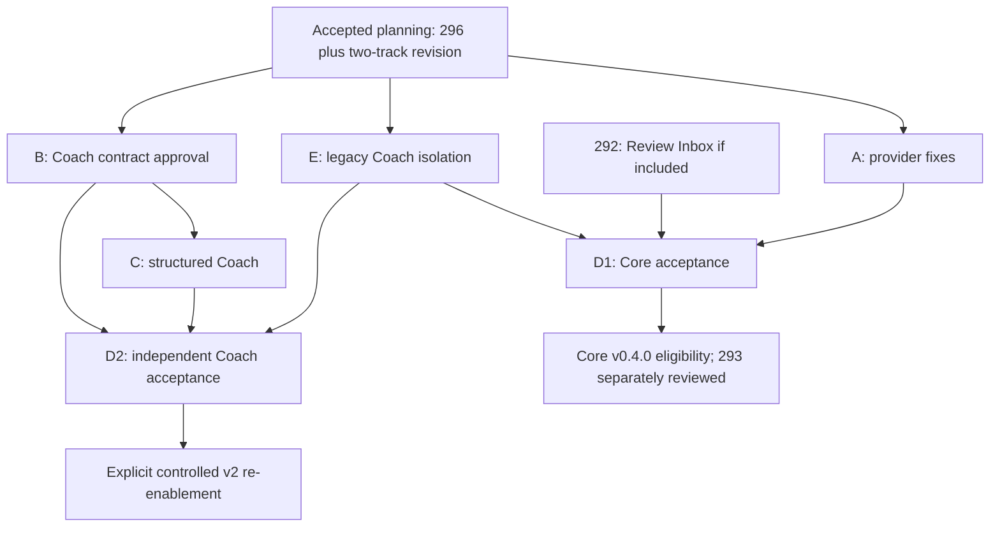

# TradeLens Core and AI Coach security roadmap

Status: two-track planning, superseding the original combined D proposal in #296. No production change or operational enablement is part of this document. AI Coach remains planned and supported; retain its code, data, API design and migration roadmap.

## Interrupted-work recovery

Recovery snapshot: main `51866f51e05d0cbabd751cd2d2d6a362f67e7cc8`; #296 already merged at that SHA from head `744eb98293cefc68044e8737d2fb9c8209cbcff1`. API/Web/title CI passed on that exact head; no unresolved review threads. Original P1 evidence and all 39 file classifications are preserved. The owner checkout and original documentation worktree are clean; no implementation branches or new Issues were created by the interrupted run. Open and closed Issues were searched; News #46/#57, localization #109 and IBKR #15 are not equivalent remediation work items.

| Item | Existing state at recovery | Already completed | Remaining action |
|---|---|---|---|
| PR #296 acceptance | MERGED | Documentation review, CI, normal squash merge | Preserve; new docs-only PR for revised policy |
| Issue A | Not created | Detailed proposal | Create from accepted roadmap |
| Issue E | Not created | Detailed proposal | Tighten safe enablement; create |
| Issue B | Not created | Contract draft | Create independent design review |
| Issue C | Not created | Implementation proposal | Create; blocked on B approval |
| Original Issue D | Proposal only, no Issue/discussion to migrate | Combined acceptance definition | Preserve history in #296; replace with D1/D2 |
| Core gate D1 | Not created | New owner decision | Create independent Core acceptance |
| Coach gate D2 | Not created | New owner decision | Create independent recovery acceptance |

The live central work-item index is the **Security recovery roadmap** section of [Issue #244](https://github.com/HoesenBruce/TradeLens/issues/244). Populate it with actual Issue URLs only after this revised plan is accepted on main; keep the historical #296 snapshot unchanged. Labels A/E/B/C/D1/D2 below are symbolic, not invented GitHub numbers.

## Product boundary and dependencies

Core development proceeds independently: SBI import/accounting, account/portfolio valuation, analytics, journals/trade plans, Review Inbox #292/#273, OCR after A, News analysis, multi-account analysis, Setup analytics/Mistake Tax #274. Core **release eligibility** requires independently proven server isolation E and D1; unrelated development need not wait for C.

News analysis has its own Core confidentiality boundary even though it currently shares Coach transport. E inventories/isolates unsafe shared paths, and D1 must validate whichever News functions the candidate exposes. A fixes errors, not arbitrary successful News text. If that path is unsafe it stays unavailable pending independent remediation, without coupling to Coach C/D2. Manual News workflows remain available.

D1 has **no dependency on B, C or D2**. D2 never blocks an isolated Core release. A/E/B may proceed in separate environments in parallel. C starts only after B is accepted. E is mandatory before exposing an integrated Coach path, and remains effective until D2 and explicit operational authorization. Neither track authorizes release/deployment automatically.

## Issue A — Extract independent provider-error confidentiality fixes from #295

**Priority:** P0.

**Background:** main lacks OCR, IBKR and notification provider-diagnostic protection even though #294's ownership fixes merged. #295 mixes reusable fixes with blocked Coach output guards.

**Scope:** shared safe error formatting, OCR extraction/model discovery and handler response, IBKR direct/background sync, webhook and Expo per-ticket failures, new status persistence, historical DTO readback, safe logging. Apply inventory A and eligible C hunks from reviewed SHA. Include both owner-only OCR/Coach model-discovery callers because they share `ocr.ListModels`; do not broaden settings permissions.

**Non-goals:** Coach free-text acceptance, News successful-output redesign, accounting/import semantics, historical row deletion/rewrites, provider success-payload audit, new vendor SDK or dependency.

**Dependencies:** current main/#294; helper included in this PR, not a mandatory separate foundation PR. No dependency on B, C, D2 or #295 merge. Independently build against current main; independent security review required before merge.

**Acceptance:**

1. No synthetic diagnostic marker appears in API body/header, persisted last_error, owner/member status readback or captured log across HTTP status/body, transport URL, malformed response, timeout and cancellation.
2. Owner configuration test/model requests reach mocks; denied JWT/PAT member requests make zero provider calls and zero DB changes. Successful OCR still parses, confirms and saves legitimate data.
3. IBKR polling/retry, errors.Is pending/cancel/timeout, successful import and Expo DeviceNotRegistered cleanup retain behavior. No default/SBI accounting drift.
4. Nonempty old status errors render generic messages without writes; empty and success status stay meaningful. Hash unrelated tables and verify only owned status rows change on failed background work.
5. Diff contains no outputGuard, Coach per-note safety claim or copied obsolete recommendation B; all error identity/unwrap callsites reviewed.

**Tests:** existing providererrors/alerts/flexsync/ocr tests; selected real-route JWT/PAT matrix and async/log/readback cases; full Go tests/vet/race, Web tests/typecheck/build, real disposable API OCR browser happy/review/confirm/readback/cancel/retry and relevant notification/IBKR error UI. Existing intercepted OCR E2E is supplemental. Required CI on exact final head. Assertions log case IDs/hashes, never actual fixtures or bearer credentials.

**Release impact:** removes independent blockers; does not make Coach or Phase 1 release-ready. Complexity small–medium, estimated 1–3 engineer-days plus review, contingent on extraction validation.

## Issue E — Isolate legacy AI Coach behind server-enforced availability policy

**Priority:** P0. **Background:** confirmed ordered cross-note SSE disclosure in #295 occurs before final rejection. Disabling only a Web button leaves APIs/history accessible.

**Scope:** centralized server availability, default disabled for new and upgraded deployments; JSON/SSE/fallback/alternate/direct service routes; raw legacy history, shared unsafe AI paths, exports/shares/caches; JWT/PAT; clear non-sensitive Web unavailable capability. Preserve existing code/data for future migration. Inventory News separately as described above.

**Non-goals:** permanent Coach removal, deleting/reinterpreting historical data, C implementation, unrelated auth/accounting changes, or changing live configuration/deployment in this task.

**Dependencies:** accepted planning and main/#294; independent of A/B/C for development. Independent security acceptance required.

**Acceptance:**

1. Real JWT/PAT owner/member/anonymous routes cannot emit unsafe JSON/SSE/history when disabled; zero upstream calls, zero review writes, unchanged unrelated table hashes. Direct/alternate/fallback/job invocation cannot bypass policy.
2. Default disabled, precedence of DB/env configuration, restart/hot reload and stale tokens tested. No environment variable or owner-only setting can re-enable unsafe legacy generation. Enabled requests require a capable v2 build plus D2-approved candidate and explicit configuration; otherwise fail closed.
3. Existing legacy rows remain byte-for-byte intact and return fixed safe placeholders; no unsafe model metadata/snippets via readback, exports, shares or caches. User change/logout and old service-worker/open-tab behavior tested; already copied bytes cannot be recalled.
4. Disable/revocation cancels in-flight operations before further emission. Unavailable/error/progress messages and logs are server controlled. No private settings added to capability DTOs.
5. Web unavailable state is exercised through a real API; hiding controls is never isolation proof. Core/manual News and Review Inbox flows remain independently usable.
6. Independent reviewer verifies full entry-point inventory and bypass attempts; document configuration semantics and safe rollback. No live setting is changed by merging the implementation alone.

**Tests:** two-user real-route JWT/PAT and spy provider, status/DB hashes, restart/race/in-flight/caching; full Go/vet/race, Web/type/check/build, Chromium E2E and exact-head required CI. Synthetic data only; mobile outside current scope.

**Release impact:** primary prerequisite for D1; no B/C/D2 prerequisite for proving legacy isolation. D2 is mandatory to restore v2 Coach. Complexity small–medium, estimated 1–3 engineer-days plus independent review.

## Issue B — Approve structured AI Coach output contract

Live work item: [#300](https://github.com/HoesenBruce/TradeLens/issues/300).
[Exact contract and approval packet](coach-output-contract-v1.md); independent
approval and named boundary owners remain pending. This does not change D1.

**Priority:** P1.

**Background:** aggregate rejection occurs after irreversible note disclosure; finite free-text recognition cannot be the primary boundary.

**Scope:** approve [schema/rendering/SSE](coach-secure-output-design.md), fact allowlist and predicates, private prompt exclusion, finite template/locale catalog, explicit indirect-channel limit, [storage/legacy/API/rollback](coach-security-migration-plan.md), News AI scope and containment. Assign an owner to each boundary in C.

**Non-goals:** production implementation, experimental provider use with real secrets, expanding template catalog beyond useful minimum, asserting universal leakage prevention.

**Dependencies:** this documentation and verified independent finding; can proceed while A/E are implemented.

**Acceptance:**

1. Security reviewer agrees every renderable value has server-catalog or typed owned-fact provenance; no private config accessor, model prose or arbitrary number enters rendering.
2. Exact schema keys/types/enums/limits/terminal/fallback semantics are written; duplicate/unknown fields, references, missing facts and ownership are fail-closed.
3. Every event is safe before flush; provisional means completion only. Cancel, retry, persistence failure, commit-disconnect and old clients have unambiguous behavior.
4. Five locales, legacy withheld UX, additive storage and safe rollback are approved. Personalized prose loss is explicit; no private custom-prompt fallback.
5. Residual provider selection/timing channel and external-provider input privacy are stated; no unsupported noninterference guarantee.

**Tests:** design traceability review, disposable mock schema/template proof (16 illustrative tests already pass), adversarial review of possible escape fields and fact registry. B does not need full product test reruns solely for prose changes.

**Release impact:** independent design approval enables C; B does not block Core D1 or a Core-only release. Complexity medium, 1–2 focused review days after stakeholder response.

## Issue C — Implement versioned Coach findings, server rendering and safe migration

**Priority:** P1.

**Background:** #295's per-note guard cannot be accepted. The Web Coach must retain useful incremental feedback through a strict output vocabulary.

**Scope:** transport/input separation; exact decoder and template predicates; request-local account-scoped fact snapshots; versioned renderer and five locales; v2 SSE/blocking/fallback; additive SQLite/PostgreSQL storage; readback validation/placeholders; safe v1 client adapter; Web parser/hook/capability/cache/privacy/cancel changes; permanent security regression. News analysis is independently developed/accepted on the Core track; do not make its recovery depend on C.

**Non-goals:** arbitrary-text “advanced mode”, automatic historical text conversion, new accounting or review-journal semantics, mobile UI implementation, trade execution, broad AI platform abstractions.

**Dependencies:** B must be approved before C begins. E availability controls must remain enforced for any integrated/exposed C path; E is not a prerequisite for isolated development after B. Reuse A helpers when integrated without importing unsafe Coach guards. Recommended scoped PRs: C1 backend schema, typed fact resolution and rendering; C2 safe SSE/JSON and Web integration; C3 structured persistence and legacy migration. Each intermediate merge stays disabled and runnable; C2 cannot advertise completed persistence before C3 exists. D2, not a configuration switch or C merge alone, gates re-enablement.

**Acceptance:**

1. Historical plaintext, structured fragment, folded Base64, malformed provenance and ordered multi-note fixtures cannot reach client fields, headers/logs/history or durable output under JWT/PAT. Preserve original regression intent when old guard internals disappear; add the published failing unit and real-route oracle to permanent CI before removal/refactor.
2. Unknown/duplicate fields, template IDs, arbitrary text/numeric params, forged foreign/current-account refs, missing/null facts, unsupported versions, budgets and malformed/trailing/partial records reject before finding emission. Fuzz parser and enforce bounded resource use.
3. Successful findings render only approved templates/facts; actual HTTP client sees a finding while provider end is deliberately withheld. Fixed server progress occurs during preparation/model wait, with no raw deltas or fake percentages. Later failure shows only previously safe provisional findings followed by generic error and no completed row.
4. Cancel/disconnect/timeout/fallback/retry/concurrent users terminate safely, do not duplicate findings/commits or mix users, and commit-disconnect reconciles by scoped idempotency/history. Database snapshots prove no unrelated mutation.
5. Completed transaction survives restart/readback; legacy and corrupt/unknown versions return placeholders unchanged; migrations and rollback validated on SQLite/PostgreSQL. Locale switch uses pinned catalogs; current ownership checked again.
6. Old-client contract works through safe adapter only; new Web happy/inverse/empty/read-back/re-entry/cancel/reset/both transition directions exercised against real disposable API, five locales, keyboard and mobile-width Web layouts, stale tab/service worker and privacy masking. Screenshots inspected for material states. No unhandled Coach promise errors allowed.

**Tests:** all preceding plus `go test ./... -count=1`, `go vet ./...`, `go test -race ./... -count=1`; repeated targeted security/concurrency suite; Web full tests, TypeScript, Vite+ check/build; Chromium Playwright against real disposable API with synthetic mock provider; required exact-head CI. Mobile not validated/outside scope. Real vendors and deployed proxy/storage require D2/deployment evidence separately.

**Release impact:** required only to enable v2 Coach. Complexity high, rough 7–12 engineer-days plus independent review; no confidence interval from implementation exists yet. Avoid deadline-driven free-text fallback.

## Issue D1 — Validate TradeLens Core with legacy Coach isolated

**Priority:** P0 release gate. **Background:** the original combined D proposal coupled two products' acceptance. Core may ship safely while Coach recovery remains open only if isolation is independently proven.

**Scope:** independent A/E review, cross-user/account authorization, included Review Inbox #292/#273 integration, accounting/analytics/main regression, exact candidate CI/E2E and deployment safety evidence. Retain the confirmed Coach vulnerability as unresolved in legacy code but unreachable through supported release surfaces.

**Non-goals:** approving/implementing Coach C, closing D2, declaring the unsafe generator fixed, automatic #292/#293 merge, release, deployment, tag or Issue #244/#273 closure.

**Dependencies:** A and E. #292 integration only if included in the selected release; document included/excluded contents explicitly. **No dependency on B, C or D2.**

**Acceptance:**

1. Independent provider-error and legacy Coach isolation reviews PASS on current candidate: every JSON/SSE/fallback/history/alternate/cache path tested; zero disabled provider calls or review writes; fail-closed defaults and rollback configuration confirmed.
2. User/account JWT/PAT isolation PASS. Included Review Inbox filters, own/foreign trade/tag/preference writes, field preservation, dismiss/restore/readback, two-device behavior and alert dedup PASS on integrated main. If excluded, record exclusion; do not claim integration PASS.
3. SBI/import/reversal/accounting, portfolio valuation, analytics, journal/plans, multi-account, OCR and exposed News regressions PASS. No new semantics or historical rewrite. Unsafe shared News paths remain contained independently of Coach redesign.
4. Full `go test ./...`, `go vet ./...`, `go test -race ./...`; Web tests, TypeScript/check/build; Chromium real-API E2E; required CI and final-main security smoke PASS on actual release-candidate SHA. No inherited old-head PASS or skipped required Web case.
5. Release configuration leaves unsafe Coach unavailable, cannot enable legacy via env/owner exception, and preserves data. #293 is refreshed/reviewed separately after accepted contents; no release readiness from documentation alone.
6. Explicit Docker, Render Demo and NAS verification plan records intended artifacts/source SHA, config precedence, auth/registration/demo policy, storage migrations/backup rollback, proxy buffering/timeouts/cancellation, cache behavior and provider boundaries. Run checks in the intended target before publication under separate authorization; record untested targets as blocked/excluded, never PASS.

**Tests/evidence:** independent adversarial corpus plus permanent pre-error multi-note regressions; API/database/header/log evidence with sanitized IDs/hashes, full local and exact-head remote suites. Distinguish local/mock, actual deployment and owner-confirmed results. A verified inaccessible legacy path is an isolation PASS, not a free-text security fix.

**Release impact:** after all D1 gates, Core may be eligible for v0.4.0 with Coach unavailable while C/D2 remain open. Publication/deployment still need separate explicit authorization. Complexity medium–high, 2–4 engineer-days plus independent review/access.

## Issue D2 — Validate structured AI Coach before re-enablement

**Priority:** P1. **Background:** AI Coach is retained, but C implementation/green CI alone cannot authorize exposing it after the confirmed #295 confidentiality defect.

**Scope:** independent B/C implementation review, schema/template/fact ownership, pre-flush SSE/JSON, persistence/readback/migration, old/new clients, functional Web, full historical attack corpus and controlled re-enablement plan.

**Non-goals:** blocking an isolated Core release, authorizing legacy bypass, replacing D1/Core regressions, automatic production enablement or publication.

**Dependencies:** B, C and E. No change to D1 dependencies.

**Acceptance:**

1. No arbitrary provider text enters display fields, error/progress/model metadata, logs or stored display content. Reject unknown/duplicate/missing fields, invalid versions/templates, arbitrary strings/numbers and unauthorized fact references before emission.
2. Template predicates and user/account/trade references validated before every finding flush. Whole event transcript, successful JSON/fallback and pre-error cross-note attack corpus independently checked; no final-rejection-after-disclosure loophole.
3. Safe finding arrives before withheld provider completion; progress, cancellation, timeouts, disconnect/commit/retry/idempotency and concurrent JWT/PAT remain functional and isolated.
4. Structured completion persists safely; legacy/unknown/corrupt/rotated-secret history is safely withheld without destructive changes. SQLite/PostgreSQL migration/rollback and pinned catalog versions pass.
5. Old/new clients, five locales, privacy mode, stale cache, re-entry/reset/cancel/error/retry and real-API Coach Chromium E2E pass. Full Go/vet/race/Web/type/build/required CI pass on accepted head.
6. Independent security reviewer approves the actual enabled implementation and explicit residual indirect-channel limitations. D2 records exact accepted candidate, deployment-specific smoke and rollback plan; operator enablement separately authorized and capability checked. No public/multi-user enablement before D2 PASS; no unsafe single-user legacy bypass.

**Tests:** permanent historical P1 regressions plus independently authored schema/fact/stream/storage adversarial tests, full suites and target proxy/provider validation. Mock proof alone is insufficient for deployment acceptance.

**Release impact:** blocks AI Coach availability only; does not block D1/Core-only release. Complexity medium–high, 2–4 engineer-days plus independent review.

## Ordered execution and release policy

1. Accept this docs-only two-track revision; create/reuse A/E/B/C/D1/D2 and record actual URLs in the central #244 roadmap index. Do not create original D as a seventh item.
2. Cloud environment A: provider extraction; Cloud environment E: containment and unavailable Web UX; independent architecture reviewer B in parallel. Separate short-lived branches/worktrees and focused PRs; refresh each against latest main before merge acceptance.
3. After independent A/E acceptance, assess #292 integration on current main, then D1. Core feature work including #274 remains independently developable; no Coach dependency is introduced.
4. After B approval, implement C in scoped disabled PRs. Assign D2 to an independent reviewer after C; keep E effective until D2 and explicit re-enablement authorization.
5. For v0.4.0: A PASS + E independent PASS + included #292 acceptance + final-candidate D1 PASS + safe unavailable Coach configuration. Refresh/review #293 separately. **C and D2 are not prerequisites.**

Planning acceptance is not security implementation acceptance. Current #295 stays Draft, #292/#293 stay unmerged, #244/#273 stay open. No production code, config, release/tag/image or deployment action is part of this recovery task.

## Evidence and retained limitations

#296's exact-head API/Web/title CI passed before its verified squash merge. Its 39-file static audit, disposable 16-test structured sketch and reproduced cross-note FAIL are preserved in [split assessment](pr295-split-assessment.md); these do not prove production recovery. [Architecture C](coach-secure-output-design.md) and [migration](coach-security-migration-plan.md) retain schema, server rendering, bounded streaming, compatibility and rollback detail. The updated roadmap changes scheduling and removes unsafe legacy enablement exceptions, not the confirmed P1 verdict.

Both `READY_FOR_PR_292_INTEGRATION` and `READY_FOR_V040_RELEASE` remain **NO** until implementation and independent acceptance. A/E implementation and B review may start once this plan is accepted. No claim that actual deployments or mobile have been validated.
