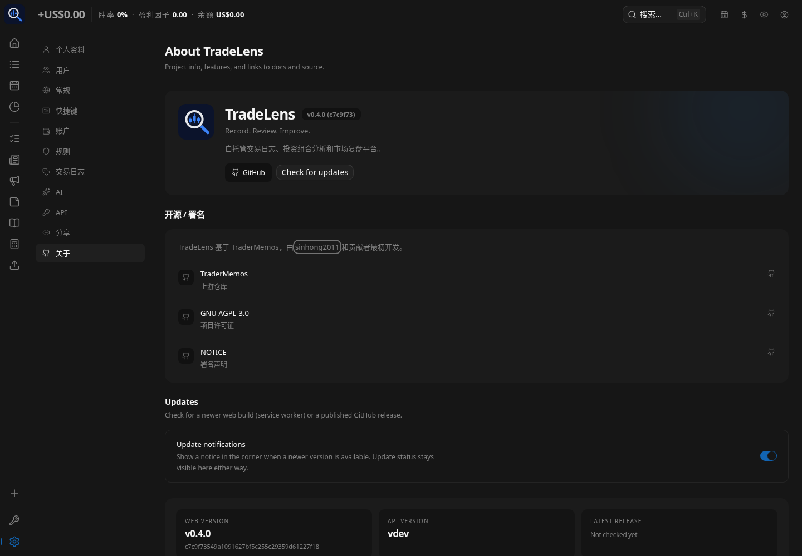
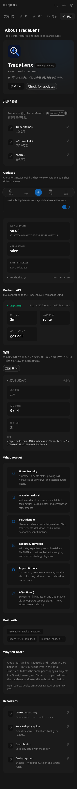
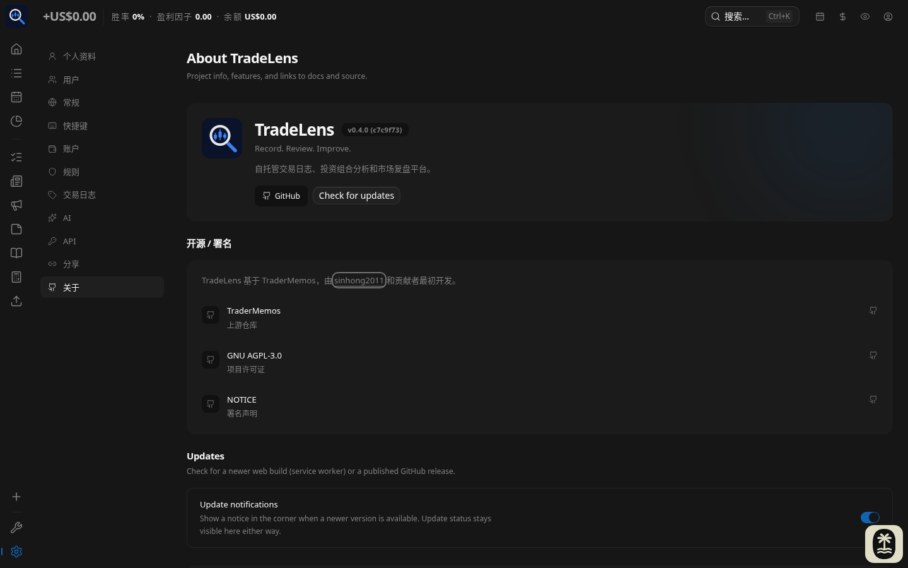
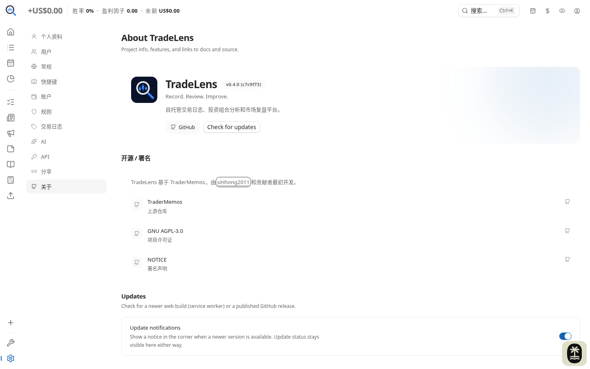
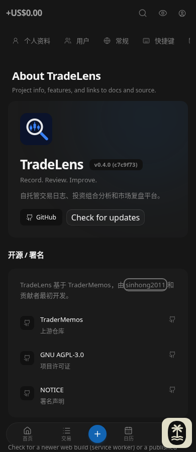
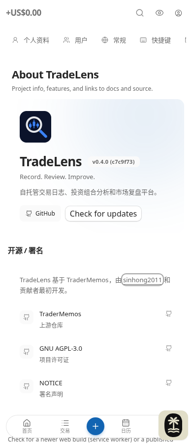

# Issue 318 — compact About attribution

## Change and license review

Remove the standalone original-upstream-author profile/card and its unused copy/avatar.
Keep the existing localized attribution sentence, link `sinhong2011` to
https://github.com/sinhong2011, and retain the existing TraderMemos repository,
GNU AGPL-3.0 and NOTICE links under Open source / Attribution. The inline author
link is underlined, has a visible keyboard focus outline, and uses
`target="_blank" rel="noopener noreferrer"` like the existing external links.

Before implementation, reviewed LICENSE (AGPL-3.0 sections 0, 4, 5 and 7), NOTICE
and THIRD_PARTY_NOTICES.md. These require preserving applicable legal notices,
license access and attribution; no repository term requires a separate author
profile/card. Equivalent author/contributor credit and the license/NOTICE entry
points remain. LICENSE, NOTICE, THIRD_PARTY_NOTICES.md and the distributed Web
third-party notice text are byte-for-byte unchanged from the base.

## Validation

Base: `c7c9f73549a1091627bf5c255c29359d61227f18` (v0.4.0).

- Settings component tests: 26 passed, including five localized About cases
  (en, zh-CN, zh-HK, ja, ko). Assert complete attribution, exactly one author
  occurrence, absence of the old card/avatar, four safe link targets and Tab /
  Shift+Tab focus order.
- Playwright Chromium: two end-to-end cases passed at 1440px and 390px. Each
  switches through all five languages via General, returns to About, checks
  attribution and card removal, opens all four links with Enter, checks new-tab
  destinations and `window.opener === null`, verifies focus order and no
  horizontal overflow, and reloads to verify persistence.
- Used Playwright because the Codex built-in browser was unavailable in this
  session. Web ran from the working tree at `http://127.0.0.1:36341`, connected
  to an API built from the base checkout at `http://127.0.0.1:46025/api/v1` with a
  fresh disposable SQLite database and synthetic owner. Successful system-info
  responses were awaited; service workers were disabled. No API code changed.
- External GitHub document responses were fulfilled locally in browser tests;
  navigation targets, safe opener behavior and keyboard activation were
  exercised, without testing GitHub page availability. API responses were real.
- Inspected the rendered desktop and narrow screenshots below. Attribution wraps
  on narrow Web and the remaining resources follow the self-hosting section
  directly. No new cancel/reset/toggle behavior exists for this read-only change.
- Re-ran the checked-in PR acceptance tests with Web :5318 and a real API built
  from the same unchanged API sources on :8319, using a fresh QA database/user/account.
  Inspected additional Simplified Chinese viewport screenshots at 1440px and
  390px in both dark and light themes. Attribution wraps and legal links remain
  reachable; the author link retains a visible keyboard focus outline.
- Full Web unit suite (`vp test run --maxWorkers=2`): 198 files / 1245 tests passed.
- `vp check`: passed, 0 errors / 347 warnings.
- `tsc -b --noEmit` and `vp build`: passed.
- `git diff --check` and unchanged legal-file comparison: passed.

No API test suite or mobile validation was run; API code is unchanged and mobile
is outside current fork scope. Existing zh-CN About sections outside the product
intro/attribution still fall back to English, as before this change.

## Screenshots

